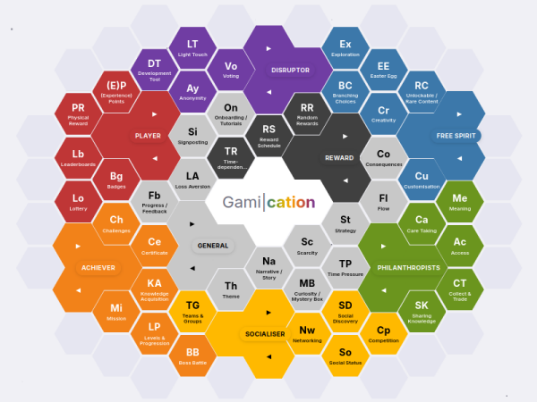
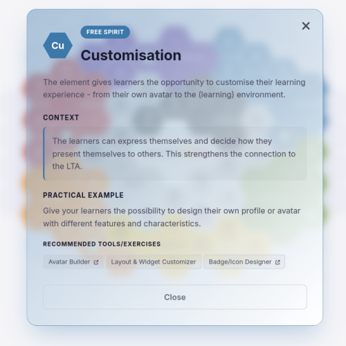

# Gami|cation

## The Learning-Teaching Adventure

**Welcome to Gami|cation – The Learning-Teaching Adventure** – the exciting game that changes the world of learning and teaching!

Gami|cation – The Learning-Teaching Adventure was developed to help you design gamified learning and teaching arrangements (LTA). Motivate your students in a unique way by integrating Gami|cation's hints into your teaching and sparking enthusiasm for learning.

## Play Modes

Gami|cation offers two distinct play modes:

### 📋 Compendium

**Create your own LTA plan.** Explore the gamification elements and build a personalized gamification strategy for your learning and teaching arrangement. Add mechanics to your personal plan to design your own approach.

### 🧩 Matching Tile

**Remember the tiles and challenge yourself.** A memory-based matching game that helps you get to know the different usage types and gamification elements in a fun and engaging way.

## What Makes Gami|cation Special?

### Versatile and Flexible

Gami|cation is available in **German** and **English** and can be played and used both **analog** and **digitally**. This means you can use it anywhere and anytime for the development of your LLA.

### Usable in Various Scenarios

Whether as a matching game for better familiarization with the usage types or as support in the conception of your own LTA.

### The Goal of the Game

Gami|cation interactively guides you through the different usage types and into the fascinating world of gamification.

## The Game Field

Gami|cation offers an exciting game field based on **Marczewski's Periodic System**. We have carefully selected **46 elements**, each represented on a card. Your task is to explore the world of gamification.

**Are you ready to step onto the game field and explore the secrets of Gami|cation? Then take your cards and let's play!**

## How to Play

1. **Visit** [Gami|cation on itch.io](https://bondoki.itch.io/gamication).
2. **Choose a play mode** and start exploring.

No download or installation is required—play directly in your web browser.

## How to Play - Local Version

1. **Download** the HTML file *GamiCation.html*.
2. **Open** the file in any modern web browser (Chrome, Firefox, Edge, Safari).
3. **Choose a play mode** and start exploring.

That's it! The application is fully self-contained and runs entirely in your browser – no installation or server required.

## How to Modify / Adjust the Tiles

To customize the tiles (e.g., change labels, icons, or categories):

1. **Open** the HTML file in a text editor (e.g., VS Code).
2. **Search** for `tiles` – the tile definitions start at **line 2013** (or nearby, depending on version).
3. Edit the tile properties (name, description, icon, category) as needed.

## Technical Details

- **Technologies**: HTML5, CSS3 (Tailwind CSS), JavaScript, Font Awesome 6.4.0.
- **Design & Development**: Developed by TU Dresden CIDS-CODIP.
- **Coded by**: TU Dresden CIDS-ZIH.

## Credits

- 🎯 **Design and Development** 🎲: L. Christa Friedrich, Matthias Heinz, Josefin Müller, and Michelle Pippig
- 🎨 **Graphics** 🖼: L. Christa Friedrich, Matthias Heinz, Josefin Müller, and Michelle Pippig
- ❤️ **Code** 🤖: Ron Dockhorn and LLMs
- 🖊 **Icons** 📄: [Font Awesome 6.4.0](https://fontawesome.com/)

## Acknowledgements

RD thanks the Deutsche Forschungsgemeinschaft (DFG, German Research Foundation) for its support through the CRC1415 "Chemistry of Synthetic Two-Dimensional Materials", Project INF – project number 417590517.

## License

- **Text and Images**: [CC BY-NC 4.0](https://creativecommons.org/licenses/by-nc/4.0/)
- **Source Code**: [The Unlicense](https://unlicense.org/)

## Academic Reference

Developed based on Andrzej Marczewski and the LOS project by L. Christa Friedrich, Matthias Heinz, Josefin Müller, and Michelle Pippig in the "Cluster Digital Learning and Gaming Cultures".

> Friedrich, L.C., Heinz, M., Müller, J., Pippig, M. (2025). Gami|cation: Gamification Within (Higher) Education. In: Vendrell Vidal, E., Cukierman, U.R., Auer, M.E. (eds) *Advanced Technologies and the University of the Future*. Lecture Notes in Networks and Systems, vol 1140. Springer, Cham.
> DOI: [10.1007/978-3-031-71530-3_25](https://doi.org/10.1007/978-3-031-71530-3_25)
